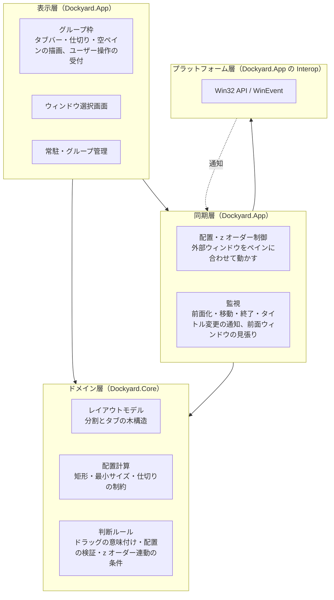
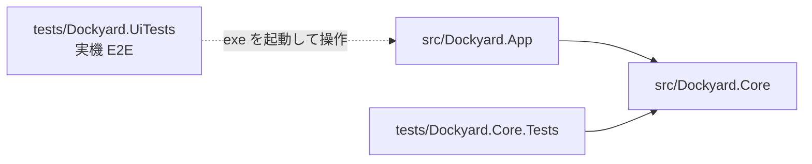
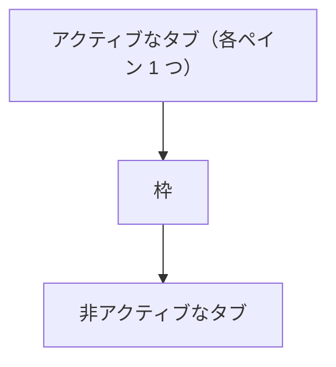
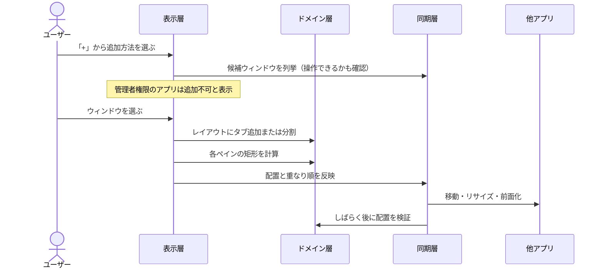
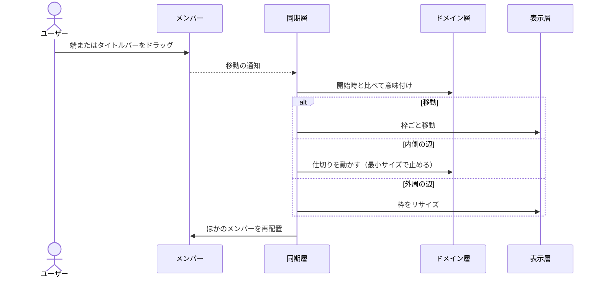
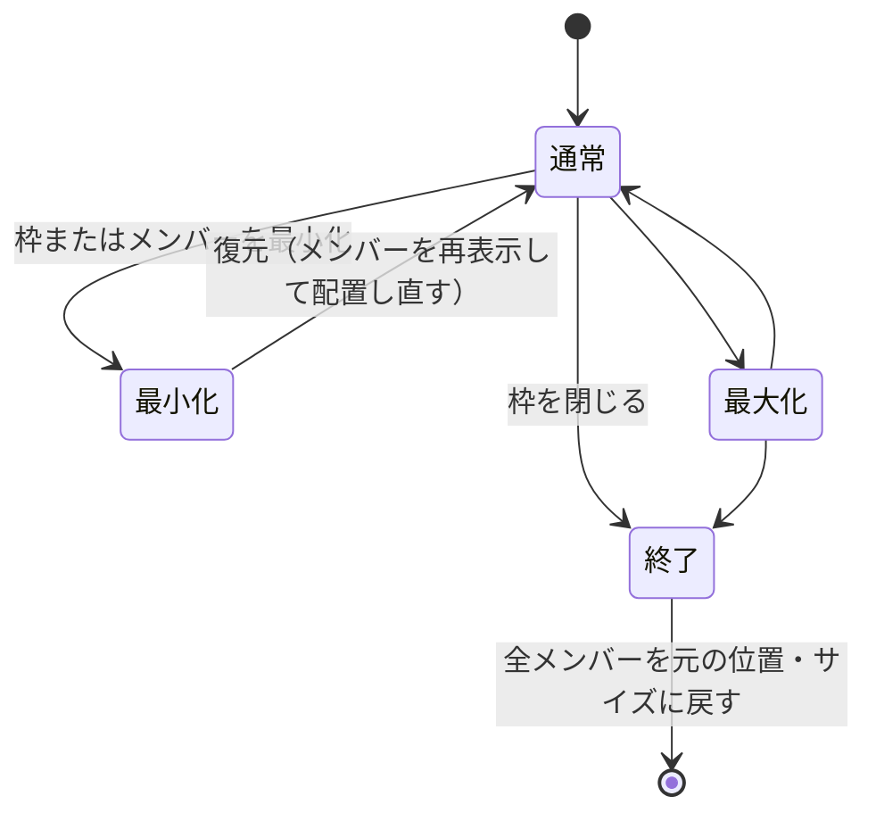
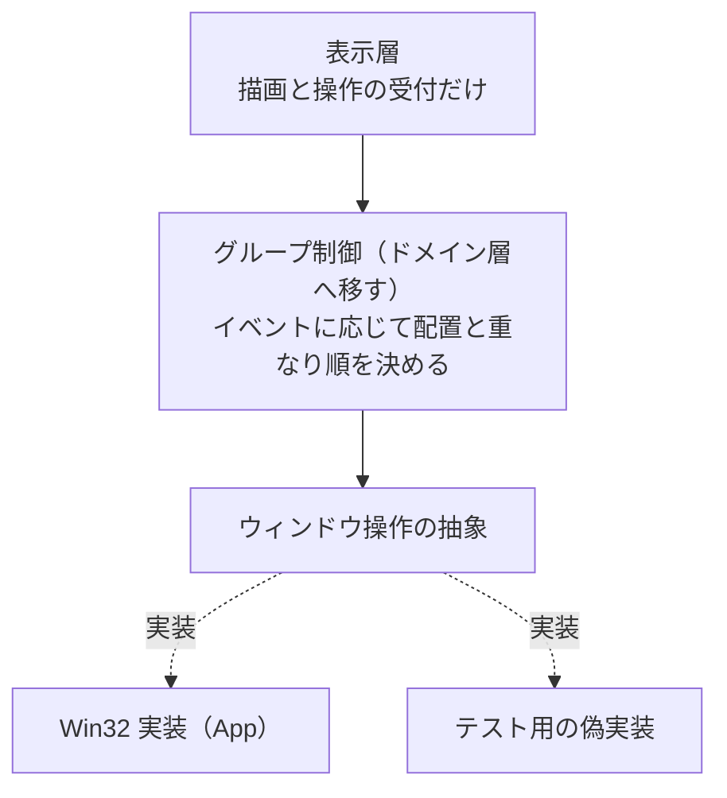

# Dockyard 設計書

別々のアプリのウィンドウを 1 つの枠（グループ）にまとめ、タブと分割ペインで配置する Windows 常駐アプリの設計。仕様のすり合わせ結果は [mock.html](mock.html) にある。

## 1. 前提

| 項目 | 内容 |
|---|---|
| 対象 OS | Windows 11 |
| 技術 | C# / .NET 10 / WPF。Win32 は P/Invoke で直接呼ぶ |
| 埋め込み方式 | 外部ウィンドウを reparent しない。枠のペイン位置に合わせて移動・リサイズし続ける（位置同期方式） |
| グループ | 1 グループ = 1 枠ウィンドウ + レイアウト（縦横分割 + タブ） |
| 常駐 | タスクトレイ |

reparent（SetParent）を採らないのは、UWP・一部の Electron アプリ・DPI が混在する環境で壊れやすく、Dockyard が落ちると子ウィンドウが巻き添えになるため。位置同期方式なら、Dockyard が落ちても各アプリは普通のウィンドウとして残る。

## 2. レイヤー構成

| 層 | 置き場所 | 役割 | Windows 依存 |
|---|---|---|---|
| 表示層 | `Dockyard.App` | 枠とダイアログの描画、操作の受付、トレイ常駐 | あり（WPF） |
| 同期層 | `Dockyard.App` | 外部ウィンドウの移動・重なり順の制御、イベントの監視 | あり（Win32） |
| ドメイン層 | `Dockyard.Core` | レイアウトの構造と計算、各種の判断ルール | なし |
| プラットフォーム層 | `Dockyard.App/Interop` | Win32 API と WinEvent の呼び出し | あり |

ドメイン層は Windows API も WPF も参照しないので、単体テストだけで検証できる。表示層と同期層はどちらも今は `GroupWindow` に同居している（10 章）。

### プロジェクトの依存

`Dockyard.UiTests` はプロジェクト参照を持たず、ビルド済みの `Dockyard.exe` を外から操作する。

## 3. ドメイン層の考え方

- **レイアウトモデル**: 二分木。葉（ペイン）が複数のウィンドウをタブとして持ち、節が縦か横に 2 分割する。ペインが空になると親の分割を畳む。
- **配置計算**: 枠の大きさから各ペインの矩形を求める。アプリごとの最小サイズを積み上げて、仕切りがそれ以上寄らないよう制約する（仕様 Q9）。
- **判断ルール**: Win32 の観測値から「何をすべきか」を決める部分を取り出したもの。
  - ドラッグの意味付け: 移動か、どの辺のリサイズか
  - 配置の検証: 指定どおり収まったか、再送するか、最小サイズとして覚えるか
  - z オーダー連動: 枠の重なり順が変わるとき、タブを一緒に動かすか

## 4. 同期層の考え方

### 配置

ペインの内容領域に、外部ウィンドウの見える範囲を合わせる。Windows 10/11 のウィンドウは周囲に見えないリサイズ枠を持つので、その分を補正する。応答しないアプリで Dockyard が止まらないよう、移動は非同期で送る。

### 重なり順

- アクティブなタブは枠の直上、非アクティブなタブは枠の直下に置く。非アクティブなタブは枠に隠れるが、表示状態のままなので Alt+Tab や Waypoint の一覧に出る（仕様 Q11）。
- 枠が前面に出るときは、Windows が枠を上げる前に割り込み、先にタブを上げて枠をその直下に差し込む。後から上げ直すと空白ペインが一瞬見える。

### 監視

前面化・ドラッグ開始と終了・移動・タイトル変更・終了を WinEvent で受け取る。前面化の通知は届かないことがあるため、前面ウィンドウを定期的に確認して補う。

## 5. 主な処理の流れ

### ウィンドウの追加

### メンバーのドラッグ

外部ウィンドウの見えないリサイズ枠は、仕切りや枠の外周にかぶさる。このため「メンバーの端を引く」操作をレイアウト操作として解釈する。

## 6. 枠の状態

## 7. エラー処理

- WinEvent の通知はネイティブから呼ばれ、ここで例外が漏れるとプロセスが即終了する。通知の受け口で例外を受け止めて記録する。
- UI の例外は記録して動作を続ける。グループが巻き添えで消えるより、1 回の操作が失敗するほうが被害が小さい。
- 回復できない例外では、全メンバーを元の位置に戻してから終了する。
- ログは `%LOCALAPPDATA%\Dockyard\dockyard.log`。`DOCKYARD_TRACE=1` で詳細なトレースを出す。

## 8. 既知の制約

| 制約 | 理由 | 対応 |
|---|---|---|
| 管理者権限のアプリは入れられない | UIPI により一般権限からは移動できない | 選択画面で追加不可と表示する |
| 前面化の通知が届かないことがある | Windows が通知しない場合がある | 前面ウィンドウの定期確認で補う |
| 仕切りを直接つかめない | メンバーの見えないリサイズ枠がかぶさる | メンバーの端のドラッグを仕切り操作として扱う |
| Dockyard を強制終了するとメンバーがその場に残る | 位置同期方式なので戻す処理が走らない | 未対応（起動時の復元を検討） |

## 9. テスト

| 種類 | 対象 | 内容 | 実行 |
|---|---|---|---|
| 単体テスト | ドメイン層 | レイアウト操作、配置計算、最小サイズ、判断ルール | `dotnet test` |
| 実機 E2E | アプリ全体 | 本物の exe とテスト用ウィンドウを UI Automation と実マウスで操作し、表示・枠内・重なり順・空白ペイン・エラーログ・元位置への復帰を検査 | `dotnet run --project tests/Dockyard.UiTests`（デスクトップを 1 分ほど操作するので手動） |

## 10. 課題と今後の構成案

表示層と同期層が `GroupWindow` 1 クラスに同居している。重なり順や前面化の不具合はすべてここで起き、単体テストでは捕まえられず、E2E でしか検出できなかった。次の分割を提案する（未実施）。

グループ制御を同期層から切り離し、ウィンドウ操作を抽象の裏に隠せば、「前面化されたらこの順で重ねる」といった判断を単体テストで確認できる。

そのほかの未実装: タブのドラッグによるドッキング、レイアウトの保存と復元（Q3）、タブバー配置 B / C、キーボードショートカット、グループ名の変更。
