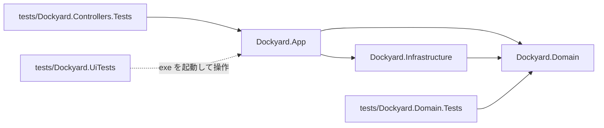
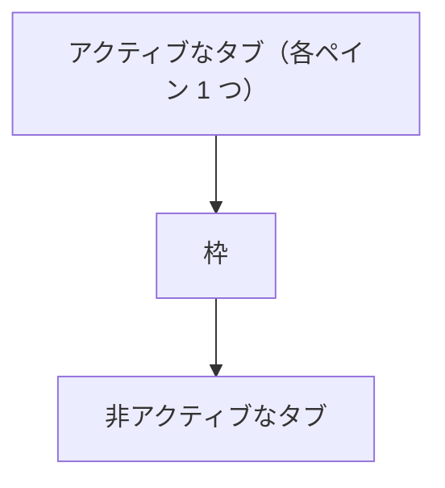
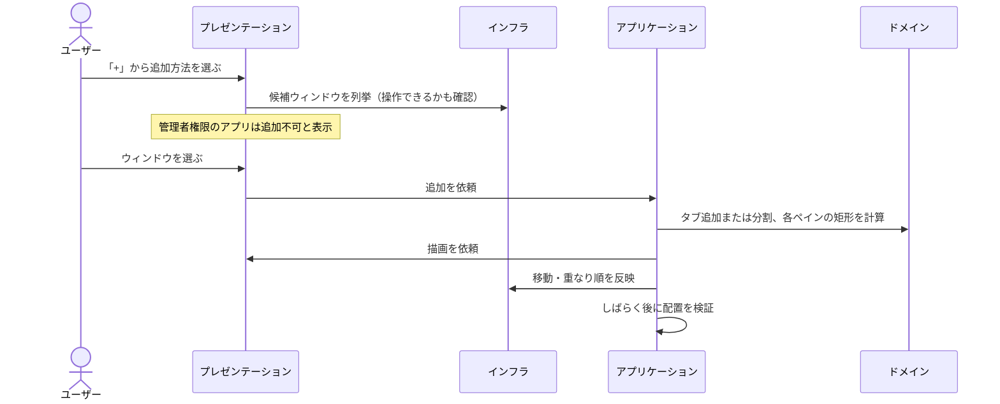
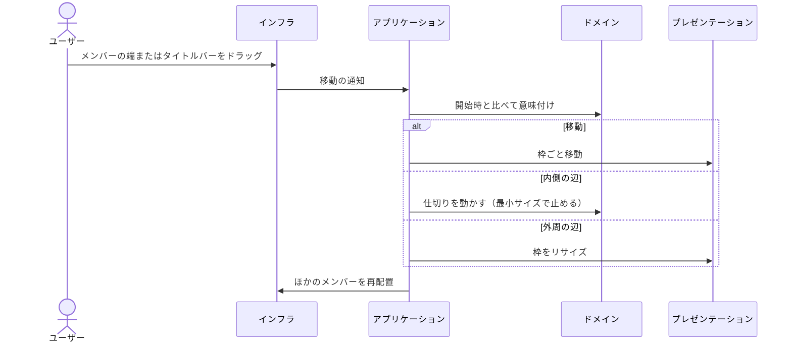
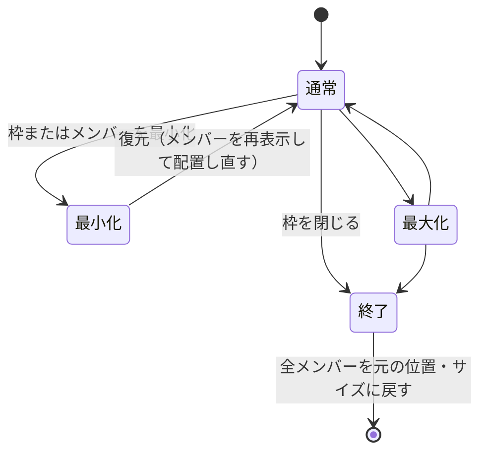

# Dockyard 設計書

別々のアプリのウィンドウを 1 つの枠（グループ）にまとめ、タブと分割ペインで配置する Windows 常駐アプリの設計。仕様のすり合わせ結果は [mock.html](mock.html) にある。

## 1. 前提

| 項目 | 内容 |
|---|---|
| 対象 OS | Windows 11 |
| 技術 | C# / .NET 10 / WPF。Win32 は P/Invoke で直接呼ぶ |
| 埋め込み方式 | 外部ウィンドウを reparent しない。枠のペイン位置に合わせて移動・リサイズし続ける（位置同期方式） |
| グループ | 1 グループ = 1 枠ウィンドウ + レイアウト（縦横分割 + タブ） |
| 常駐 | タスクトレイ |

reparent（SetParent）を採らないのは、UWP・一部の Electron アプリ・DPI が混在する環境で壊れやすく、Dockyard が落ちると子ウィンドウが巻き添えになるため。位置同期方式なら、Dockyard が落ちても各アプリは普通のウィンドウとして残る。

## 2. プロジェクト構成

画面と操作の制御は `Dockyard.App` にまとめ、制御処理を `Controllers` フォルダ・`Dockyard.App.Controllers` 名前空間に置く。レイアウトの構造と計算は `Dockyard.Domain`、Win32 操作は `Dockyard.Infrastructure` に分ける。

| プロジェクト・フォルダ | 役割 | 依存先 | Windows 依存 |
|---|---|---|---|
| `Dockyard.App` | 枠とダイアログの描画、操作の受付、トレイ常駐、組み立て | Domain、Infrastructure | あり（WPF） |
| `Dockyard.App/Controllers` | グループ制御。「いつ・どのウィンドウを・どこへ・どの順に」を決める | ドメインの計算、ウィンドウ操作のインターフェース | 処理自体は WPF・Windows API を呼ばない |
| `Dockyard.Domain` | レイアウトの構造と計算、判断ルール | なし | なし |
| `Dockyard.Infrastructure` | ウィンドウ操作のインターフェースと Win32 実装、イベント監視、候補列挙、ログ | Domain | あり（Win32） |

制御処理は偽のウィンドウ操作・枠・スケジューラで単体テストする。App を参照する制御テストは Windows 向けになり、Domain のテストは引き続き Windows に依存しない。

### インターフェース

| 定義場所 | インターフェース | 実装 |
|---|---|---|
| Infrastructure | ウィンドウ操作と物理ピクセル座標型 | Win32 |
| App/Controllers | 枠の描画、座標変換、移動・リサイズ | WPF の枠ウィンドウ |
| App/Controllers | 処理の後回し、タイマー | WPF のディスパッチャ |

### プロジェクトの依存

## 3. ドメイン層

- **レイアウトモデル**: 二分木。葉（ペイン）が複数のウィンドウをタブとして持ち、節が縦か横に 2 分割する。ペインが空になると親の分割を畳む。
- **配置計算**: 枠の大きさから各ペインの矩形を求める。アプリごとの最小サイズを積み上げて、仕切りがそれ以上寄らないよう制約する（仕様 Q9）。
- **判断ルール**: ドラッグが移動か、どの辺のリサイズかを決める。配置したウィンドウが指定どおり収まったか、再送するか、最小サイズとして覚えるかを決める。

## 4. グループ制御（App/Controllers）

グループ 1 つにつき 1 つのグループ制御を持ち、次を決める。

- **配置**: ペインの内容領域に、外部ウィンドウの見える範囲を合わせる。配置後しばらくして収まり具合を検証する。
- **重なり順**: アクティブなタブは枠の直上、非アクティブなタブは枠の直下に置く。非アクティブなタブは枠に隠れるが、表示状態のままなので Alt+Tab や Waypoint の一覧に出る（仕様 Q11）。

- **枠が前面に出るとき**: Windows が枠を上げる前に割り込み、先にタブを上げて枠をその直下に差し込む。後から上げ直すと空白ペインが一瞬見える。
- **タブバー配置 B**: タブバーはメンバーのタイトルバーに重ねて描く。枠はメンバーの下にあるので、タブだけを描いた透明なオーバーレイウィンドウを別に持ち、アクティブなタブのさらに上に置く。オーバーレイの透明な部分はクリックを下のウィンドウへ通し、オーバーレイ自体はアクティブにならない。
- **ダイアログ表示中**: タブを最前面ではなくダイアログの直下に並べる。
- **メンバーのドラッグ**: 外部ウィンドウの見えないリサイズ枠は、仕切りや枠の外周にかぶさる。このため「メンバーの端を引く」操作をレイアウト操作として解釈する。

## 5. インフラストラクチャ層

- **ウィンドウ操作**: Win32 で移動・リサイズ・重なり順を変える。Windows 10/11 のウィンドウは周囲に見えないリサイズ枠を持つので、その分を補正する。応答しないアプリで止まらないよう、移動は非同期で送る。
- **イベント監視**: 前面化・ドラッグ開始と終了・移動・タイトル変更・終了を WinEvent で受け取る。前面化の通知は届かないことがあるため、前面ウィンドウを定期的に確認して補う。
- **追加候補の列挙**: Alt+Tab に出るウィンドウを列挙し、操作できるか（管理者権限のアプリでないか）を確かめる。
- **ログ**: `%LOCALAPPDATA%\Dockyard\dockyard.log`。`DOCKYARD_TRACE=1` で詳細なトレースを出す。

## 6. 主な処理の流れ

### ウィンドウの追加

### メンバーのドラッグ

## 7. 枠の状態

## 8. エラー処理

- WinEvent の通知はネイティブから呼ばれ、ここで例外が漏れるとプロセスが即終了する。インフラ層の受け口で例外を受け止めて記録する。
- UI の例外は記録して動作を続ける。グループが巻き添えで消えるより、1 回の操作が失敗するほうが被害が小さい。
- 回復できない例外では、全メンバーを元の位置に戻してから終了する。

## 9. 既知の制約

| 制約 | 理由 | 対応 |
|---|---|---|
| 管理者権限のアプリは入れられない | UIPI により一般権限からは移動できない | 選択画面で追加不可と表示する |
| 他アプリのウィンドウを最前面に上げられないことがある | Win11 のメモ帳やペイントなどは、他プロセスからの SetWindowPos(HWND_TOP) を黙って無視する（Dockyard が前面でも） | 最前面へは topmost を経由して上げる。「あるウィンドウの直下へ」の移動は制限されないので、2 つ目以降はそれで並べる |
| 前面化の通知が届かないことがある | Windows が通知しない場合がある | 前面ウィンドウの定期確認で補う |
| 仕切りを直接つかめない | メンバーの見えないリサイズ枠がかぶさる | メンバーの端のドラッグを仕切り操作として扱う |
| Dockyard を強制終了するとメンバーがその場に残る | 位置同期方式なので戻す処理が走らない | 開いているグループとメンバー（ウィンドウハンドルと追加前の位置）を `session.json` に書き続け（ドラッグ中は書かず、マウスを離してから 1 回書く）、正常終了で消す。起動時に残っていれば、同じウィンドウ（同じハンドルで同じ exe）をグループに戻す |

## 10. テスト

| 種類 | 対象 | 内容 | 実行 |
|---|---|---|---|
| 単体テスト | ドメイン層 | レイアウト操作、配置計算、最小サイズ、判断ルール | `dotnet test` |
| 単体テスト | App/Controllers | 偽のウィンドウ操作・枠・スケジューラを差し込み、追加・タブ切替・分割・重なり順・ダイアログ表示中・ドラッグ・最小サイズ学習・最小化と最大化を検証 | `dotnet test` |
| 実機 E2E | アプリ全体 | 本物の exe とテスト用ウィンドウを UI Automation と実マウスで操作し、表示・枠内・重なり順・空白ペイン・エラーログ・元位置への復帰を検査 | `dotnet run --project tests/Dockyard.UiTests`（デスクトップを 1 分ほど操作するので手動） |
